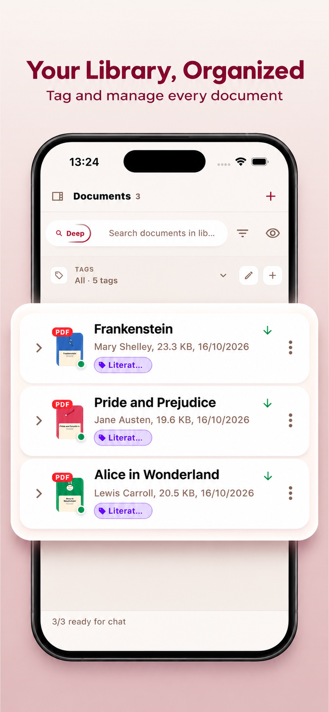
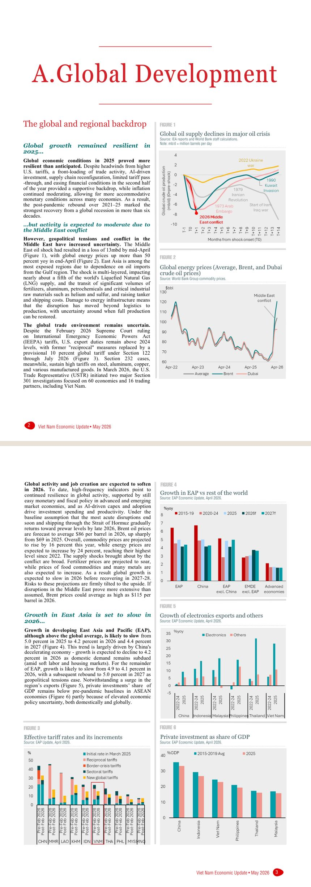

# Rafetus

Turn your document collection into a knowledge library you can explore with AI. With **Rafetus** you can store, read, search, and ask questions about your documents in one app.

{fig-alt="Rafetus app icon" width="160"}

**Product:** [rafetus.vn](https://rafetus.vn)  
**App Store:** [Rafetus - AI Document Manager](https://apps.apple.com/app/rafetus-quản-lý-tài-liệu-ai/id6768253916)  
**Web sign-in:** [auth.rafetus.vn](https://auth.rafetus.vn/login?client=web)

{fig-alt="Rafetus Ask AI screen"}

## Highlights

- **Central document library** — Store PDF and DOCX files, organize them in folders, and tag them for easy management.
- **Smart search** — Find information across documents and notes quickly without rereading everything.
- **Ask AI (Rafai)** — Ask questions and get answers grounded in your own document content, with cited sources.
- **Read and annotate** — Highlight key passages, select text, and ask AI to explain difficult sections.
- **Knowledge connections** — Build an AI knowledge graph that links documents and notes so you can discover useful relationships.

{fig-alt="Rafetus AI library"}

{fig-alt="Rafetus deep search"}

{fig-alt="Rafetus reader with selection"}

## Tutorial flow

Eight short steps from the [Rafetus tutorial](https://rafetus.vn/tutorial):

### Library

1. Upload documents to your library (PDF and files ready for search and AI).
2. Tag your documents so you can find them again.

### Read and search

3. Read and ask AI on the page — select passages, mark what matters.
4. Deep search — find related content even without exact keywords.

### Ask AI about your documents

5. Ask AI across many documents with clear source citations.
6. Choose sources when asking AI so answers stay focused.

### Knowledge network

7. Explore the knowledge network — visualize documents, notes, and relations.
8. Link notes to build your own knowledge network step by step.

{fig-alt="Rafetus library tags"}

{fig-alt="Rafetus library folders"}

{fig-alt="Rafetus knowledge graph"}

## Rafai (AI assistant)

From [rafetus.vn/ai](https://rafetus.vn/ai):

- Connect related information across notes and documents.
- Select relevant context for each question instead of searching manually.
- Stay in control — choose which data AI can use; turn the feature off anytime.
- Conversations are not used to train models under Rafetus policy ([Privacy](https://rafetus.vn/privacy)).

## About

*Thinking Without Limits* — connecting knowledge in a unified space with artificial intelligence.

Core values (from [About](https://rafetus.vn/about)):

1. **User-centric experience** — simplify upload → organize → explore.
2. **Substantive tech** — optimize data architecture and core algorithms.
3. **Accumulating knowledge** — a foundation for long-term intellectual legacy.
4. **Absolute knowledge sovereignty** — your documents stay yours.
5. **Continuous evolution** — product and platform keep moving with user needs.

Founding team: **Lê Trí Nhân** (Administration & Lead Engineer), **Hồ Văn Thạnh** (Technical Administration & Data).

{fig-alt="Rafetus at VEU 2026"}

## Plans

Pay for plans and top up AI credit in the app ([pricing](https://rafetus.vn/pricing)):

| Plan | Price | Storage |
| --- | --- | --- |
| Free | Free forever | 500 MB |
| Plus | $14.98 / month | 20 GB |
| Pro | $29.98 / month | 100 GB |

AI credits can be topped up in-app (shared across chat and document processing).

## Infrastructure

Built on AWS, Cloudflare, and Supabase (as shown on [rafetus.vn](https://rafetus.vn)).

## Links

| | |
| --- | --- |
| Product | [rafetus.vn](https://rafetus.vn) |
| App Store | [Rafetus - AI Document Manager](https://apps.apple.com/app/rafetus-quản-lý-tài-liệu-ai/id6768253916) |
| AI | [rafetus.vn/ai](https://rafetus.vn/ai) |
| Tutorial | [rafetus.vn/tutorial](https://rafetus.vn/tutorial) |
| About | [rafetus.vn/about](https://rafetus.vn/about) |
| Support | [support@rafetus.vn](mailto:support@rafetus.vn) |
| X | [@RafetusApp](https://x.com/RafetusApp) |

Source: App Store listing, product site, and App Store screenshots. No public GitHub repo.
