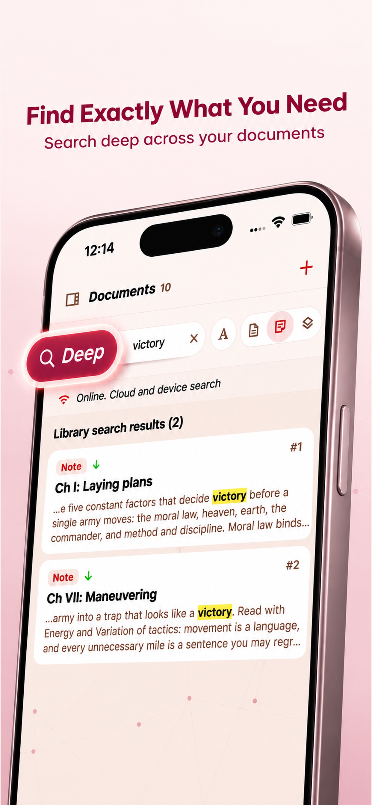
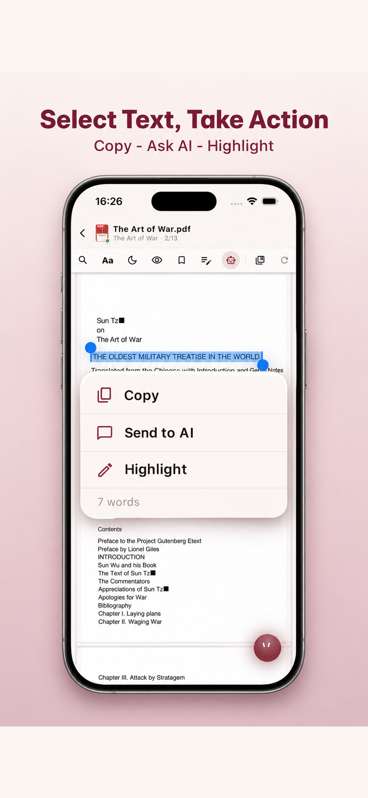

**Ứng dụng quản lý tài liệu tích hợp trí tuệ nhân tạo**

**Website** [rafetus.vn](https://rafetus.vn/)  
**App Store** [Rafetus](https://apps.apple.com/app/id6768253916)  
**Ứng dụng web** [app.rafetus.vn](https://app.rafetus.vn/)

{fig-alt="Giao diện Rafetus — Ask AI"}

## Tổng quan

Rafetus là ứng dụng quản lý tài liệu tích hợp trí tuệ nhân tạo, hỗ trợ lưu trữ, tổ chức, tìm kiếm và khai thác thông tin từ tài liệu số.

Dự án được phát triển nhằm giải quyết những khó khăn trong việc quản lý và tra cứu tài liệu khi khối lượng thông tin ngày càng lớn. Thay vì chỉ tập trung vào lưu trữ tệp, Rafetus kết hợp quản lý tài liệu, tìm kiếm ngữ nghĩa, ghi chú và hỏi đáp bằng trí tuệ nhân tạo trong cùng một hệ thống.

Điểm trọng tâm của Rafetus là khả năng truy xuất thông tin trên nhiều tài liệu, duy trì nguồn tham chiếu và thiết lập mối liên hệ giữa các nội dung thông qua đồ thị tri thức.

## Chức năng chính

### Thư viện tài liệu

Rafetus hỗ trợ lưu trữ và quản lý các định dạng tài liệu phổ biến như PDF và DOCX. Tài liệu được tổ chức theo thư mục, thẻ phân loại và thông tin mô tả, giúp việc quản lý và truy xuất thuận tiện hơn.

Sau khi tải lên, nội dung tài liệu được xử lý và lập chỉ mục để phục vụ tìm kiếm và hỏi đáp. Người dùng có thể quản lý tài liệu, ghi chú và những thông tin liên quan trong cùng một thư viện.

### Tìm kiếm chuyên sâu

Rafetus sử dụng công nghệ tìm kiếm ngữ nghĩa để truy xuất nội dung dựa trên ý nghĩa của câu truy vấn, thay vì phụ thuộc hoàn toàn vào từ khóa chính xác.

Tính năng này cho phép tìm kiếm thông tin liên quan trong nhiều tài liệu và ghi chú, kể cả khi người dùng không nhớ chính xác cách diễn đạt trong văn bản gốc.

### Đọc và ghi chú tài liệu

Trình đọc tích hợp hỗ trợ xem tài liệu, đánh dấu những đoạn quan trọng, theo dõi vị trí đọc và tạo ghi chú trong quá trình nghiên cứu.

Người dùng có thể lựa chọn trực tiếp một đoạn văn bản để yêu cầu trí tuệ nhân tạo giải thích hoặc phân tích mà không cần rời khỏi tài liệu đang đọc.

### Trợ lý trí tuệ nhân tạo Rafai

Rafai là trợ lý trí tuệ nhân tạo được tích hợp trong Rafetus, cho phép người dùng đặt câu hỏi và truy xuất thông tin từ thư viện tài liệu cá nhân.

Hệ thống có thể tìm kiếm, tổng hợp nội dung từ nhiều tài liệu và ghi chú để xây dựng câu trả lời. Các thông tin được cung cấp kèm trích dẫn nguồn, giúp người dùng kiểm tra và đối chiếu với tài liệu gốc.

Rafai cũng cho phép lựa chọn những nguồn tài liệu cụ thể trong từng phiên hỏi đáp nhằm giới hạn phạm vi truy xuất và kiểm soát ngữ cảnh sử dụng.

### Đồ thị tri thức

Rafetus hỗ trợ xây dựng đồ thị tri thức thông qua việc liên kết tài liệu và ghi chú theo những mối quan hệ xác định.

Người dùng có thể thiết lập các liên kết thể hiện sự tham chiếu, bổ sung hoặc phản biện giữa những nội dung có liên quan. Các mối quan hệ được trực quan hóa thành mạng lưới, giúp theo dõi và tổ chức kiến thức theo từng chủ đề.

Đồ thị tri thức đồng thời cung cấp ngữ cảnh bổ sung cho Rafai trong quá trình tìm kiếm và tổng hợp thông tin, kết hợp nội dung tài liệu với những liên kết do người dùng thiết lập.

{fig-alt="Đồ thị tri thức Rafetus"}

## Quyền riêng tư và dữ liệu

Rafetus được thiết kế với cơ chế kiểm soát truy cập và quản lý dữ liệu cá nhân.

Người dùng có thể lựa chọn phạm vi thông tin được cung cấp cho Rafai và chủ động tắt tính năng trí tuệ nhân tạo khi không sử dụng. Theo chính sách quyền riêng tư của Rafetus, dữ liệu cá nhân không được sử dụng để huấn luyện các mô hình trí tuệ nhân tạo.

Thông tin chi tiết được công bố tại [Chính sách quyền riêng tư](https://rafetus.vn/privacy).

## Nền tảng và gói dịch vụ

Rafetus hiện có phiên bản web và ứng dụng dành cho iPhone. Các phiên bản sử dụng chung hệ thống tài khoản để truy cập và quản lý thư viện tài liệu.

Ứng dụng cung cấp ba gói dịch vụ với dung lượng lưu trữ khác nhau.

| Gói dịch vụ | Dung lượng |
|---|---|
| Free | 500 MB |
| Plus | 20 GB |
| Pro | 100 GB |

Các tác vụ sử dụng trí tuệ nhân tạo được tính theo hệ thống tín dụng riêng, có thể bổ sung tùy theo nhu cầu sử dụng.

Thông tin chi tiết được cập nhật tại [Các gói dịch vụ](https://rafetus.vn/pricing).

## Phát triển dự án

Rafetus được phát triển bởi Lê Trí Nhân và Hồ Văn Thạnh. Hệ thống sử dụng hạ tầng dịch vụ từ AWS, Cloudflare và Supabase.

Dự án tập trung vào ba lĩnh vực chính gồm quản lý dữ liệu tài liệu, truy xuất thông tin và ứng dụng trí tuệ nhân tạo trong tổ chức tri thức cá nhân.

Định hướng phát triển tiếp theo là tiếp tục cải thiện khả năng tìm kiếm trên thư viện lớn, mở rộng các phương thức liên kết tri thức và nâng cao chất lượng truy xuất ngữ cảnh cho trợ lý Rafai.

Với triết lý **Thinking Without Limits**, Rafetus được phát triển như một nền tảng hỗ trợ tích lũy, tổ chức và khai thác tri thức lâu dài.

## Hình ảnh giao diện

{fig-alt="Thư viện tài liệu"}

{fig-alt="Tìm kiếm chuyên sâu"}

{fig-alt="Trình đọc tài liệu"}

{fig-alt="Quản lý thẻ phân loại"}

{fig-alt="Quản lý thư mục"}

## Liên kết và tài nguyên

| | |
| --- | --- |
| Website | [rafetus.vn](https://rafetus.vn/) |
| iOS | [Rafetus trên App Store](https://apps.apple.com/app/id6768253916) |
| Web app | [app.rafetus.vn](https://app.rafetus.vn/) |
| Đăng nhập | [auth.rafetus.vn](https://auth.rafetus.vn/login?client=web) |
| Rafai | [rafetus.vn/ai](https://rafetus.vn/ai) |
| Hướng dẫn | [rafetus.vn/tutorial](https://rafetus.vn/tutorial) |
| Giới thiệu | [rafetus.vn/about](https://rafetus.vn/about) |
| Gói dịch vụ | [rafetus.vn/pricing](https://rafetus.vn/pricing) |
| Privacy | [rafetus.vn/privacy](https://rafetus.vn/privacy) |
| Email | [support@rafetus.vn](mailto:support@rafetus.vn) |
| X | [@RafetusApp](https://x.com/RafetusApp) |

{fig-alt="Rafetus icon" width="120"}
