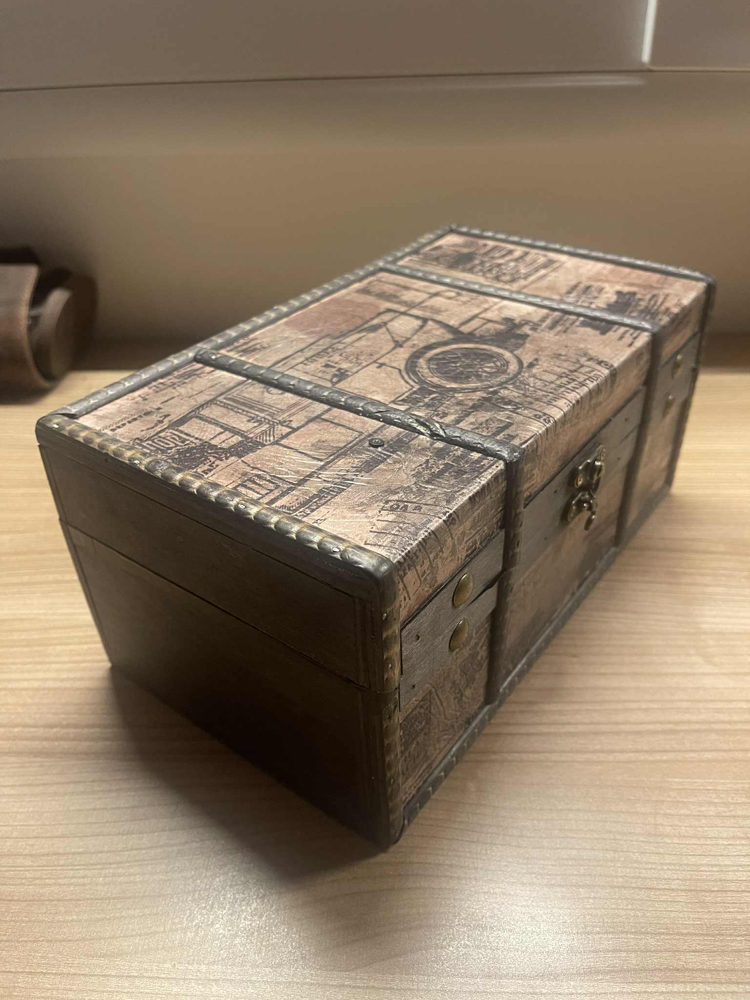
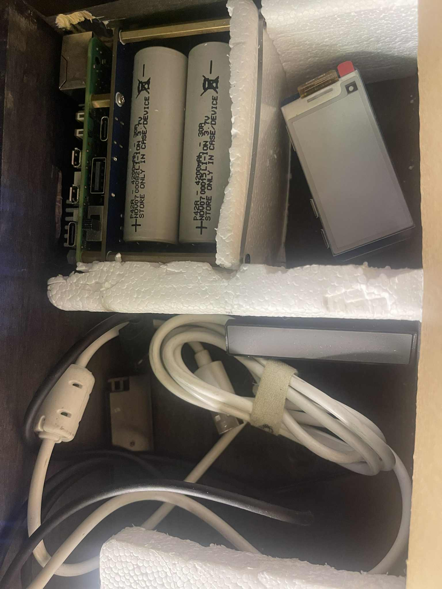
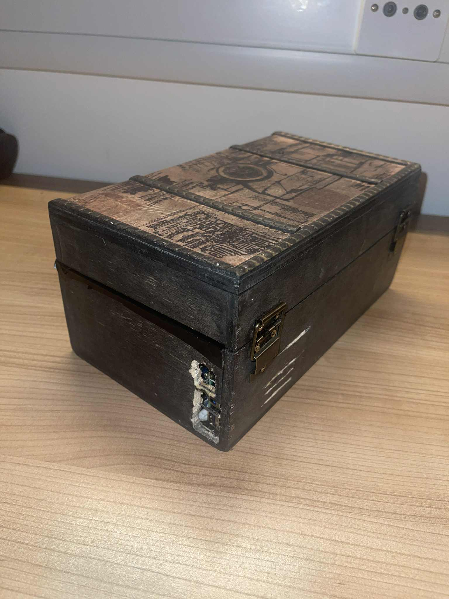
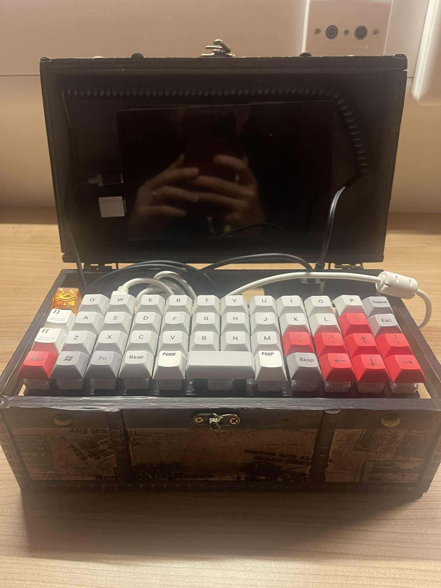

# Retro Typewriter Cyberdeck

A self-contained portable computing unit built around the Raspberry Pi 5, housed in a repurposed decorative wooden chest. Designed and assembled in London, winter 2024/2025.

{fig-alt="Cyberdeck front view"}

## Design Objectives

- Fully portable: battery-backed, no dependency on mains power
- Self-contained: display, input, compute, and networking in one enclosure
- Dual-purpose: general-purpose Linux workstation and passive 802.11 network monitoring via Pwnagotchi co-processor
- No 3D printing, no CNC: enclosure repurposed from off-the-shelf hardware

## Bill of Materials

| Component | Specification | Source | Unit Price |
|---|---|---|---|
| SBC | Raspberry Pi 5, 4GB | Amazon UK | £143.00 |
| Display | GeeekPi 7" IPS LCD, 1024x600, 60Hz, 500 cd/m2, HDMI | Amazon UK | £44.99 |
| UPS HAT | Waveshare UPS HAT (E), 5V/6A output, bi-directional fast charge, Pogo Pin connector | Amazon UK | £39.99 |
| Thermal | Raspberry Pi Active Cooler (official) | Amazon UK | £9.56 |
| Display cable | Coiled Micro HDMI to HDMI, 4K@60Hz, 0.5-2.4M | AliExpress | $3.97 |
| Internal wiring | HOQO FFC Flat Flexible Cable kit, 18 connector types | AliExpress | $10.05 |
| Enclosure | European Vintage Small Wood Box with lock, approx. 30x15x12cm | AliExpress | $4.77 |
| Keyboard | IDOBAO ID42 40%, hotswap, Kailh Box Navy switches, white keycaps | AliExpress | £18.87 |
| Battery cells | 2x 18650 Li-ion, 4200mAh, 3.7V | - | TBD |

**Total (confirmed components): ~£256.41 + $18.79 + batteries**

## System Architecture

### Compute

Raspberry Pi 5 (4GB LPDDR4X) running Ubuntu 24.04 LTS. The active cooler is fitted directly to the SoC heatspreader and routed to exhaust through a ventilation gap at the rear of the enclosure.

### Power

The Waveshare UPS HAT (E) is stacked directly on the GPIO header via Pogo Pins, supplying 5V/6A to the Pi. Two 18650 Li-ion cells (4200mAh each, ~31Wh combined at nominal voltage) are housed in the HAT's integrated battery bay. The HAT supports hot-swap charging: the system remains operational while charging via USB-C. Known issue: battery percentage readout is unreliable under Ubuntu; the HAT reports via I2C but driver support is incomplete.

### Display

The GeeekPi 7" IPS panel is mounted externally on the inner face of the lid, connected via a coiled Micro HDMI cable routed through the hinge gap. The coil accommodates lid open/close movement without cable stress. Resolution set to 1024x600 at 60Hz; display is powered directly from the HDMI port.

### Input

IDOBAO ID42 40% hotswap mechanical keyboard, fitted with Kailh Box Navy tactile-clicky switches and IDOBAO white keycaps. The 40% layout reduces footprint while retaining full alphanumeric coverage via layers. The keyboard sits external to the enclosure and connects via USB.

### Networking

The Pi's onboard BCM43455 handles primary wireless. A secondary USB Wi-Fi adapter extends range. The Pwnagotchi co-processor runs on a dedicated microcontroller with its own 2.13" e-ink status display, performing passive 802.11 handshake capture and AI-driven interaction loop independent of the main OS.

### Internal Structure

The upper compartment houses the main board stack (Pi 5, UPS HAT, cooler) and battery cells, with styrofoam-carved dividers holding each component in a fixed position to prevent movement under transport. The lower compartment is left open as a carry space for peripheral gadgets: Pwnagotchi, cables, USB adapters, or anything else in rotation. The wooden chest provides adequate rigidity and incidental EMF containment without requiring any machining.

## Photos

{fig-alt="Cyberdeck internals"}

{fig-alt="Cyberdeck back"}

{fig-alt="Cyberdeck point of view"}

{fig-alt="Cyberdeck bench test"}

## Known Issues

| Issue | Status |
|---|---|
| UPS battery percentage unreliable via I2C on Ubuntu | Open |
| Lid closure requires partial cable disconnection | By design (constraint of enclosure geometry) |
| No active ventilation: relies on passive gap at rear | Acceptable under normal load; throttles under sustained CPU stress |

## OS and Software

- Ubuntu 24.04 LTS (Raspberry Pi build)
- Pwnagotchi: standalone AI on co-processor, does not share OS with main system
- Primary use: writing, research, terminal work

## Links

| | |
| --- | --- |
| Repo | [github.com/letrinhandn/retro-typewriter-cyberdeck](https://github.com/letrinhandn/retro-typewriter-cyberdeck) |
| README | [README + photos](https://github.com/letrinhandn/retro-typewriter-cyberdeck#readme) |

Source: project README.
