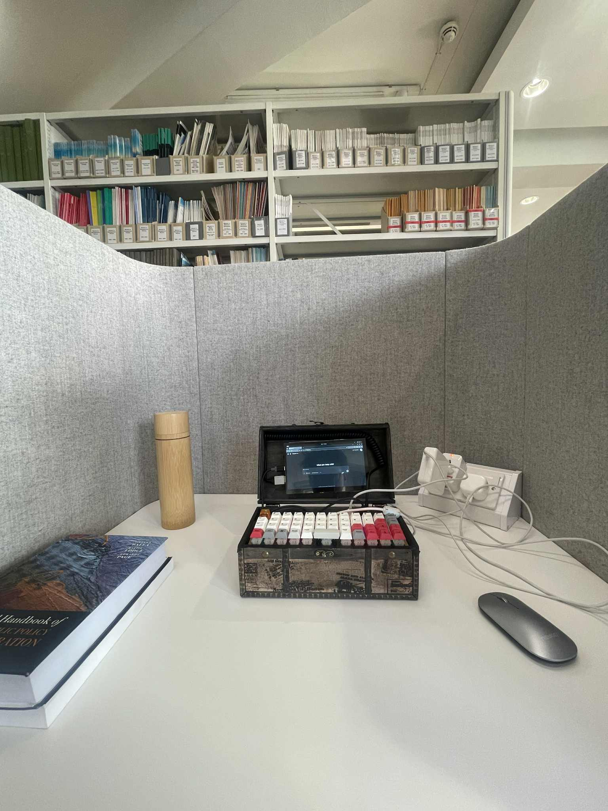

::: {.lang-vi}
**Máy tính xách tay tự chế quanh Raspberry Pi 5**

**Mã nguồn** [github.com/letrinhandn/retro-typewriter-cyberdeck](https://github.com/letrinhandn/retro-typewriter-cyberdeck)

## Tổng quan

Cyberdeck tự chứa, dựng quanh **Raspberry Pi 5**, đặt trong hộp gỗ trang trí tái sử dụng. Thiết kế và lắp tại London, đông 2024/2025.

Đây là khối máy portable: có pin, màn hình, bàn phím, máy tính và mạng trong cùng một khối — vừa làm workstation Linux, vừa kèm Pwnagotchi theo dõi 802.11 thụ động.

{fig-alt="Hình 1. Mặt trước Retro Typewriter Cyberdeck." fig-align="center"}

## Mục tiêu thiết kế

- Portable: có pin, không phụ thuộc ổ cắm
- Self-contained: display + input + compute + network trong một khối
- Dual-purpose: Linux workstation + passive 802.11 monitoring (Pwnagotchi)
- Không in 3D / CNC: enclosure lấy sẵn rồi lắp

## Bill of Materials

| Component | Specification | Source | Unit Price |
|---|---|---|---|
| SBC | Raspberry Pi 5, 4GB | Amazon UK | £143.00 |
| Display | GeeekPi 7" IPS LCD, 1024x600, 60Hz, 500 cd/m2, HDMI | Amazon UK | £44.99 |
| UPS HAT | Waveshare UPS HAT (E), 5V/6A output, bi-directional fast charge, Pogo Pin connector | Amazon UK | £39.99 |
| Thermal | Raspberry Pi Active Cooler (official) | Amazon UK | £9.56 |
| Display cable | Coiled Micro HDMI to HDMI, 4K@60Hz, 0.5-2.4M | AliExpress | $3.97 |
| Internal wiring | HOQO FFC Flat Flexible Cable kit, 18 connector types | AliExpress | $10.05 |
| Enclosure | European Vintage Small Wood Box with lock, approx. 30x15x12cm | AliExpress | $4.77 |
| Keyboard | IDOBAO ID42 40%, hotswap, Kailh Box Navy switches, white keycaps | AliExpress | £18.87 |
| Battery cells | 2x 18650 Li-ion, 4200mAh, 3.7V | - | TBD |

**Tổng linh kiện đã chốt: ~£256.41 + $18.79 + pin**

{fig-alt="Hình 2. Phần cứng bên trong hộp." fig-align="center"}

## Kiến trúc hệ thống

### Compute

Raspberry Pi 5 (4GB LPDDR4X) chạy Ubuntu 24.04 LTS. Active cooler gắn trực tiếp lên SoC và thoát nhiệt qua khe phía sau enclosure.

### Power

Waveshare UPS HAT (E) gắn GPIO qua Pogo Pins, cấp 5V/6A. Hai cell 18650 (~31Wh) nằm trong bay pin của HAT. Có thể sạc USB-C khi đang chạy. Đọc % pin qua I2C trên Ubuntu chưa ổn định.

### Display

Panel GeeekPi 7" gắn mặt trong nắp, nối bằng cáp Micro HDMI xoắn qua bản lề. Độ phân giải 1024×600 @ 60Hz.

{fig-alt="Hình 3. Mặt sau và khe thoát nhiệt." fig-align="center"}

### Input

Bàn phím IDOBAO ID42 40%, Kailh Box Navy, keycap trắng. Kết nối USB, nằm ngoài enclosure.

### Networking

Wi-Fi onboard BCM43455; thêm USB adapter mở rộng. Pwnagotchi chạy trên microcontroller riêng với e-ink 2.13", bắt handshake 802.11 thụ động độc lập với OS chính.

### Cấu trúc bên trong

Ngăn trên chứa stack Pi 5 + UPS HAT + cooler + pin, cố định bằng miếng xốp. Ngăn dưới để trống mang phụ kiện: Pwnagotchi, cáp, adapter.

{fig-alt="Hình 4. Góc nhìn khi làm việc." fig-align="center"}

## Known issues

| Issue | Status |
|---|---|
| % pin UPS qua I2C trên Ubuntu chưa ổn | Open |
| Đóng nắp đôi khi cần rút cáp một phần | By design (constraint hình học hộp) |
| Thông gió thụ động: throttle khi CPU kéo dài | Acceptable under normal load |

{fig-alt="Hình 5. Thử nghiệm trên bàn." fig-align="center"}

## OS và phần mềm

- Ubuntu 24.04 LTS (Raspberry Pi build)
- Pwnagotchi: AI standalone trên co-processor, không chung OS với máy chính
- Mục đích chính: viết, nghiên cứu, làm việc terminal

## Liên kết

| | |
| --- | --- |
| Repo | [github.com/letrinhandn/retro-typewriter-cyberdeck](https://github.com/letrinhandn/retro-typewriter-cyberdeck) |
| README | [README + photos](https://github.com/letrinhandn/retro-typewriter-cyberdeck#readme) |
:::

::: {.lang-en}
**Self-contained portable computing unit around Raspberry Pi 5**

**Source** [github.com/letrinhandn/retro-typewriter-cyberdeck](https://github.com/letrinhandn/retro-typewriter-cyberdeck)

## Overview

A self-contained portable computing unit built around the Raspberry Pi 5, housed in a repurposed decorative wooden chest. Designed and assembled in London, winter 2024/2025.

Fully portable and battery-backed: display, input, compute, and networking in one enclosure — a general-purpose Linux workstation with a Pwnagotchi co-processor for passive 802.11 monitoring.

{fig-alt="Figure 1. Front view of the Retro Typewriter Cyberdeck." fig-align="center"}

## Design Objectives

- Fully portable: battery-backed, no dependency on mains power
- Self-contained: display, input, compute, and networking in one enclosure
- Dual-purpose: general-purpose Linux workstation and passive 802.11 network monitoring via Pwnagotchi co-processor
- No 3D printing, no CNC: enclosure repurposed from off-the-shelf hardware

## Bill of Materials

| Component | Specification | Source | Unit Price |
|---|---|---|---|
| SBC | Raspberry Pi 5, 4GB | Amazon UK | £143.00 |
| Display | GeeekPi 7" IPS LCD, 1024x600, 60Hz, 500 cd/m2, HDMI | Amazon UK | £44.99 |
| UPS HAT | Waveshare UPS HAT (E), 5V/6A output, bi-directional fast charge, Pogo Pin connector | Amazon UK | £39.99 |
| Thermal | Raspberry Pi Active Cooler (official) | Amazon UK | £9.56 |
| Display cable | Coiled Micro HDMI to HDMI, 4K@60Hz, 0.5-2.4M | AliExpress | $3.97 |
| Internal wiring | HOQO FFC Flat Flexible Cable kit, 18 connector types | AliExpress | $10.05 |
| Enclosure | European Vintage Small Wood Box with lock, approx. 30x15x12cm | AliExpress | $4.77 |
| Keyboard | IDOBAO ID42 40%, hotswap, Kailh Box Navy switches, white keycaps | AliExpress | £18.87 |
| Battery cells | 2x 18650 Li-ion, 4200mAh, 3.7V | - | TBD |

**Total (confirmed components): ~£256.41 + $18.79 + batteries**

{fig-alt="Figure 2. Internal hardware layout." fig-align="center"}

## System Architecture

### Compute

Raspberry Pi 5 (4GB LPDDR4X) running Ubuntu 24.04 LTS. The active cooler is fitted directly to the SoC heatspreader and routed to exhaust through a ventilation gap at the rear of the enclosure.

### Power

The Waveshare UPS HAT (E) is stacked directly on the GPIO header via Pogo Pins, supplying 5V/6A to the Pi. Two 18650 Li-ion cells (4200mAh each, ~31Wh combined at nominal voltage) are housed in the HAT's integrated battery bay. The HAT supports hot-swap charging via USB-C. Battery percentage readout via I2C on Ubuntu remains unreliable.

### Display

The GeeekPi 7" IPS panel is mounted on the inner face of the lid, connected via a coiled Micro HDMI cable routed through the hinge gap. Resolution is 1024×600 at 60Hz.

{fig-alt="Figure 3. Rear view and ventilation gap." fig-align="center"}

### Input

IDOBAO ID42 40% hotswap mechanical keyboard with Kailh Box Navy switches and white keycaps. The keyboard sits external to the enclosure and connects via USB.

### Networking

The Pi's onboard BCM43455 handles primary wireless. A secondary USB Wi-Fi adapter extends range. The Pwnagotchi co-processor runs on a dedicated microcontroller with its own 2.13" e-ink status display.

### Internal Structure

The upper compartment houses the main board stack and battery cells with styrofoam-carved dividers. The lower compartment is left open as carry space for peripherals.

{fig-alt="Figure 4. Working point of view." fig-align="center"}

## Known Issues

| Issue | Status |
|---|---|
| UPS battery percentage unreliable via I2C on Ubuntu | Open |
| Lid closure requires partial cable disconnection | By design (constraint of enclosure geometry) |
| No active ventilation: relies on passive gap at rear | Acceptable under normal load; throttles under sustained CPU stress |

{fig-alt="Figure 5. Bench test setup." fig-align="center"}

## OS and Software

- Ubuntu 24.04 LTS (Raspberry Pi build)
- Pwnagotchi: standalone AI on co-processor, does not share OS with main system
- Primary use: writing, research, terminal work

## Links

| | |
| --- | --- |
| Repo | [github.com/letrinhandn/retro-typewriter-cyberdeck](https://github.com/letrinhandn/retro-typewriter-cyberdeck) |
| README | [README + photos](https://github.com/letrinhandn/retro-typewriter-cyberdeck#readme) |
:::
