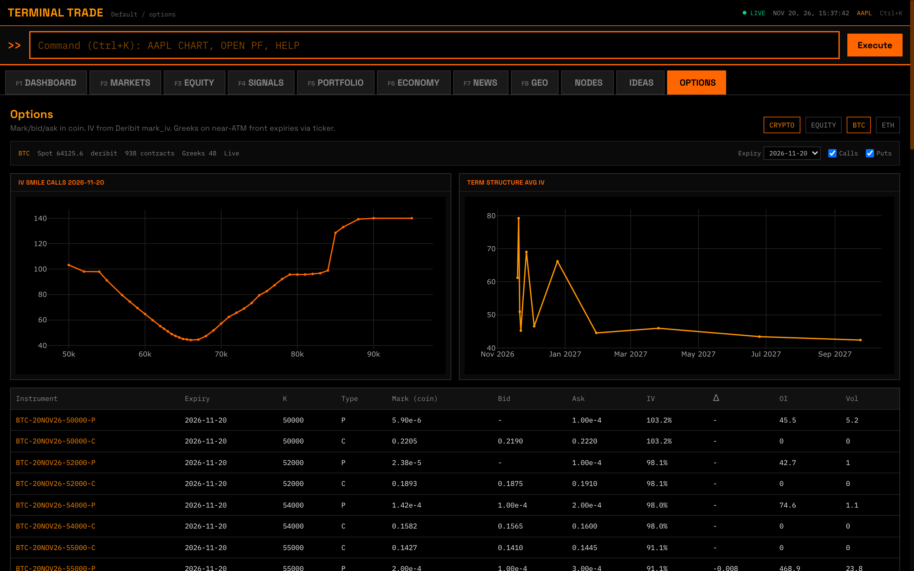

# Terminal Trade

Local market research terminal built with Next.js.

Run on your machine only. No hosted deploy. Free public data plus optional keys in `.env.local`. Not investment advice.

{fig-alt="Terminal Trade dashboard"}

## Screens

| Key | Desk | What you get |
| --- | --- | --- |
| F1 | Dashboard | Indices, FX, commodities, pulse, quote, news |
| F2 | Markets | OHLCV candles, watchlist tape, relative, correlation |
| F3 | Equity | Research workbench, financials, ownership, ESG |
| F4 | Signals | Rule-based detectors with chart markers |
| F5 | Portfolio | Paper blotter, heatmap, NAV, sectors, risk |
| F6 | Economy | FRED macro series |
| F7 | News | RSS monitor |
| F8 | Geo | Macro risk proxies, Yahoo corr, GDELT headlines |
| - | Nodes | Correlation workflow canvas |
| - | Ideas | Rules-based screener helper |
| - | Options | Deribit crypto chain or Yahoo equity chain |

{fig-alt="Markets desk"}

{fig-alt="Equity research desk"}

{fig-alt="Options desk"}

## Data sources

| Source | Used for |
| --- | --- |
| Yahoo Finance | Equities quotes, OHLCV, fundamentals, equity options |
| CoinGecko Demo | Crypto market tape |
| Coinbase Exchange | Crypto daily candles |
| FRED | Economy series |
| GDELT DOC API | Geopolitics headlines |
| Deribit | BTC and ETH options |
| alternative.me | Fear and Greed |
| UN Comtrade | US trade partners |

Optional keys (see `.env.example`): `FRED_API_KEY`, `FINNHUB_API_KEY`, `COINGECKO_DEMO_API_KEY`.

## Quick start (local)

```bash
pnpm install
cp .env.example .env.local   # optional keys for FRED / Finnhub / CoinGecko
pnpm dev
```

Open <http://localhost:4726>

Keep API keys in `.env.local` on your machine. Do not put them on a public host.

Command examples: `AAPL EQ`, `MKT`, `ECO`, `NWS`, `BTC`, `HELP`.

## API surface

Primary routes live under `/api/v1`:

- `GET/POST /api/v1/equity/quote`
- `GET /api/v1/equity/price/historical`
- `GET /api/v1/markets/panel`
- `GET /api/v1/crypto/markets`
- `GET /api/v1/equity/overview` and related research routes
- `GET /api/v1/economy/fred/series`
- `GET /api/v1/technicals/signals`
- `GET /api/v1/news`
- `GET /api/v1/geopolitics/overview`
- `GET /api/options/chain`

## Layout

```
src/app/api/v1/     HTTP routers
src/lib/platform/   providers, cache, envelopes
src/lib/data/       Yahoo, CoinGecko, Coinbase, news, Comtrade
src/components/     desk UI
public/brand/       logo, favicon, cover, backdrop
```

## License

MIT. Research and education only.

## Links

| | |
| --- | --- |
| Repo | [github.com/letrinhandn/Terminal-Trade](https://github.com/letrinhandn/Terminal-Trade) |
| Demo | [terminal-trade-iota.vercel.app](https://terminal-trade-iota.vercel.app) |
| README | [README](https://github.com/letrinhandn/Terminal-Trade#readme) |

Source: project README + screenshots from the repo.
