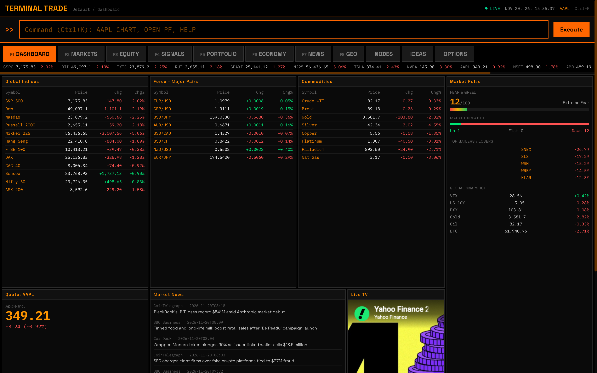

**Terminal Trade** là market research terminal chạy local bằng Next.js. Chạy trên máy bạn, dùng dữ liệu công khai (và key tùy chọn trong `.env.local`). Không phải lời khuyên đầu tư.

{fig-alt="Terminal Trade dashboard"}

## Desks

| Key | Desk | Nội dung |
| --- | --- | --- |
| F1 | Dashboard | Indices, FX, commodities, pulse, quote, news |
| F2 | Markets | OHLCV candles, watchlist, correlation |
| F3 | Equity | Research workbench, financials, ownership, ESG |
| F4 | Signals | Rule-based detectors + chart markers |
| F5 | Portfolio | Paper blotter, heatmap, NAV, risk |
| F6 | Economy | FRED macro series |
| F7 | News | RSS monitor |
| F8 | Geo | Macro risk proxies, Yahoo corr, GDELT |

Thêm: Nodes (correlation canvas), Ideas (screener), Options (Deribit / Yahoo chain).

## Data sources

Yahoo Finance · CoinGecko · Coinbase · FRED · GDELT · Deribit · alternative.me · UN Comtrade.

Optional keys: `FRED_API_KEY`, `FINNHUB_API_KEY`, `COINGECKO_DEMO_API_KEY` (xem `.env.example`).

## Quick start

```bash
pnpm install
cp .env.example .env.local
pnpm dev
```

Mở http://localhost:4726 — giữ API key trong `.env.local`, không đưa lên host công khai.

## Liên kết

| | |
| --- | --- |
| Repo | [github.com/letrinhandn/Terminal-Trade](https://github.com/letrinhandn/Terminal-Trade) |
| Demo | [terminal-trade-iota.vercel.app](https://terminal-trade-iota.vercel.app) |
| License | MIT · research / education only |

Nguồn: [README Terminal Trade](https://github.com/letrinhandn/Terminal-Trade#readme).
