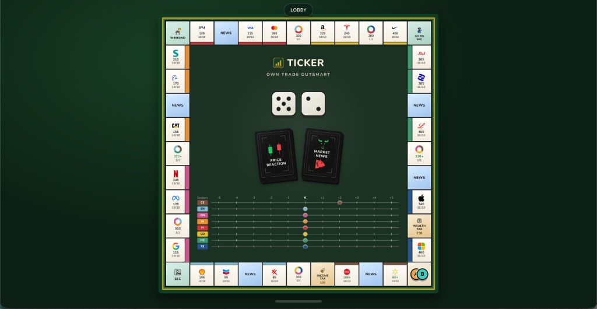
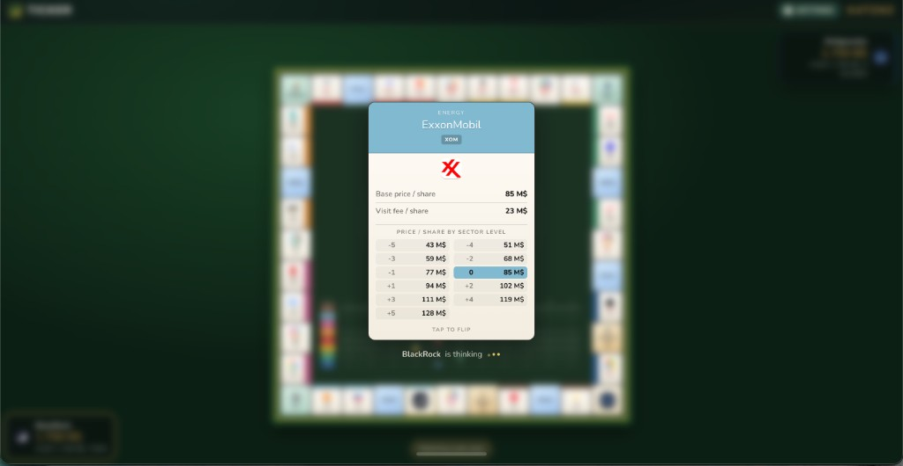
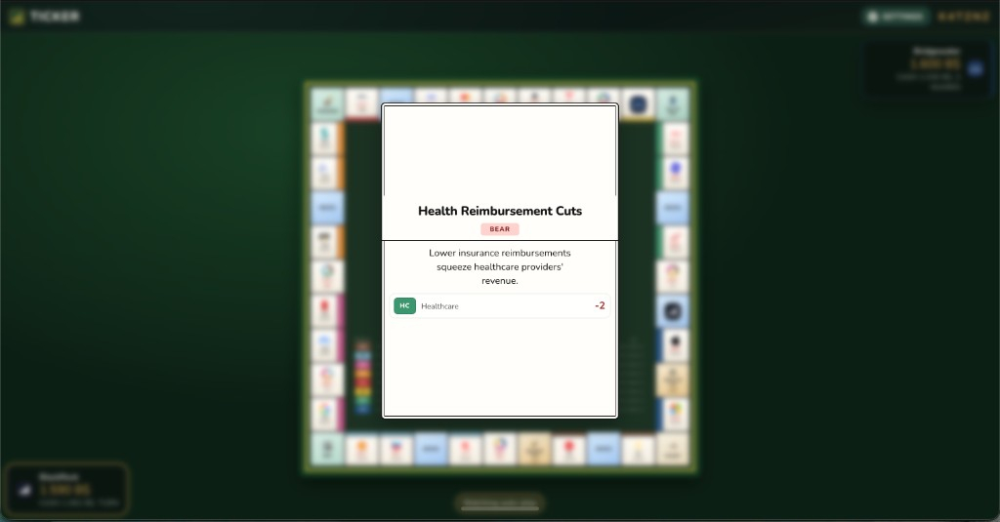

::: {.lang-vi}
**Cờ chứng khoán — board game multiplayer**

**Chơi** [tickergame.vercel.app](https://tickergame.vercel.app)  
**Tutorial** [tickergame.vercel.app/tutorial](https://tickergame.vercel.app/tutorial)  
**itch.io** [comrade-lenan.itch.io/ticker](https://comrade-lenan.itch.io/ticker)  
**Mã nguồn** [github.com/letrinhandn/ticker](https://github.com/letrinhandn/ticker)

## Tổng quan

TICKER (Cờ chứng khoán) là board game multiplayer về thị trường. Chia room code, ngồi ghế quỹ, trade đến khi còn một fund. Không cần tài khoản.

{fig-alt="Hình 1. Bìa game TICKER." fig-align="center"}

## Gameplay

Bàn xanh có ô công ty, vòng ETF, góc START / SEC / WEEKEND. Xúc xắc ở giữa. Bộ Price Reaction và Market News cạnh track 8 ngành.

{fig-alt="Hình 2. Bàn chơi TICKER." fig-align="center"}

Tạo phòng, gửi mã ngắn, chọn ghế quỹ, chơi EN hoặc VI; cũng có thể xem bot chơi.

{fig-alt="Hình 3. Phòng chờ (lobby)." fig-align="center"}

{fig-alt="Hình 4. Thẻ deed công ty." fig-align="center"}

{fig-alt="Hình 5. Khoảnh khắc mua cổ phiếu." fig-align="center"}

{fig-alt="Hình 6. Thẻ Price Reaction." fig-align="center"}

{fig-alt="Hình 7. Thẻ Market News." fig-align="center"}

## Stack

- Next.js App Router (board UI)
- Cloudflare PartyServer — một Durable Object mỗi room
- Rulebook: [MARKETPOLY_RULEBOOK_V5.md](https://github.com/letrinhandn/ticker/blob/main/docs/rulebook/MARKETPOLY_RULEBOOK_V5.md)

## Develop

```bash
npm install
cp .env.example .env.local
npm run dev:all
```

Đặt `NEXT_PUBLIC_PARTY_HOST=localhost:8888` trong `.env.local`.

- Next.js: <http://localhost:3010>
- PartyServer: port 8888

Vào lobby với tư cách spectator, rồi chọn ghế. Rời giữa ván thì ghế đó tiếp tục autoplay.

## Deploy

| Piece | Host | Production |
| --- | --- | --- |
| Frontend | Vercel | <https://tickergame.vercel.app> |
| Realtime | Cloudflare Workers | <https://ticker.letrinhan123.workers.dev> |

```bash
npm run party:deploy
npx vercel deploy --prod
```

Trên Vercel, đặt `NEXT_PUBLIC_PARTY_HOST` thành `ticker.letrinhan123.workers.dev`.

## Liên kết

| | |
| --- | --- |
| Repo | [github.com/letrinhandn/ticker](https://github.com/letrinhandn/ticker) |
| Play | [tickergame.vercel.app](https://tickergame.vercel.app) |
| itch.io | [comrade-lenan.itch.io/ticker](https://comrade-lenan.itch.io/ticker) |
| README | [README](https://github.com/letrinhandn/ticker#readme) |
:::

::: {.lang-en}
**Multiplayer stock-market board game (Cờ chứng khoán)**

**Play** [tickergame.vercel.app](https://tickergame.vercel.app)  
**Tutorial** [tickergame.vercel.app/tutorial](https://tickergame.vercel.app/tutorial)  
**itch.io** [comrade-lenan.itch.io/ticker](https://comrade-lenan.itch.io/ticker)  
**Source** [github.com/letrinhandn/ticker](https://github.com/letrinhandn/ticker)

## Overview

TICKER is a multiplayer stock-market board game. Share a room code, take a fund seat, and trade until one fund remains. No accounts.

{fig-alt="Figure 1. TICKER cover art." fig-align="center"}

## Gameplay

The green felt board has company tiles, ETF rings, and corners for START, SEC, and WEEKEND. Dice sit in the center. Price Reaction and Market News decks sit beside the eight-sector market track.

{fig-alt="Figure 2. TICKER game board." fig-align="center"}

Create a room, share the short code, pick a fund seat, and play in English or Vietnamese. You can also watch computer-controlled funds.

{fig-alt="Figure 3. Room lobby." fig-align="center"}

{fig-alt="Figure 4. Company deed card." fig-align="center"}

{fig-alt="Figure 5. Trade buy moment." fig-align="center"}

{fig-alt="Figure 6. Price Reaction card." fig-align="center"}

{fig-alt="Figure 7. Market News card." fig-align="center"}

## Stack

- Next.js App Router for the board UI
- Cloudflare PartyServer with one Durable Object per room
- Rulebook: [MARKETPOLY_RULEBOOK_V5.md](https://github.com/letrinhandn/ticker/blob/main/docs/rulebook/MARKETPOLY_RULEBOOK_V5.md)

## Develop

```bash
npm install
cp .env.example .env.local
npm run dev:all
```

Set `NEXT_PUBLIC_PARTY_HOST=localhost:8888` in `.env.local`.

- Next.js: <http://localhost:3010>
- PartyServer: port 8888

You start in the room lobby as a spectator, then join a seat. If you leave mid-game, that seat keeps autoplaying.

## Deploy

| Piece | Host | Production |
| --- | --- | --- |
| Frontend | Vercel | <https://tickergame.vercel.app> |
| Realtime | Cloudflare Workers | <https://ticker.letrinhan123.workers.dev> |

```bash
npm run party:deploy
npx vercel deploy --prod
```

On Vercel, set `NEXT_PUBLIC_PARTY_HOST` to `ticker.letrinhan123.workers.dev`.

## Links

| | |
| --- | --- |
| Repo | [github.com/letrinhandn/ticker](https://github.com/letrinhandn/ticker) |
| Play | [tickergame.vercel.app](https://tickergame.vercel.app) |
| itch.io | [comrade-lenan.itch.io/ticker](https://comrade-lenan.itch.io/ticker) |
| README | [README](https://github.com/letrinhandn/ticker#readme) |
:::
