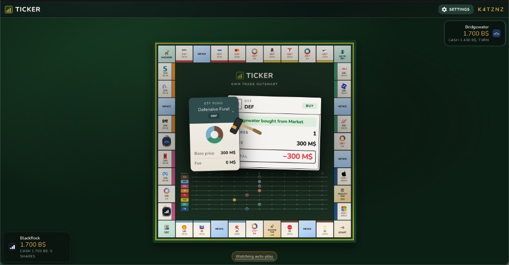
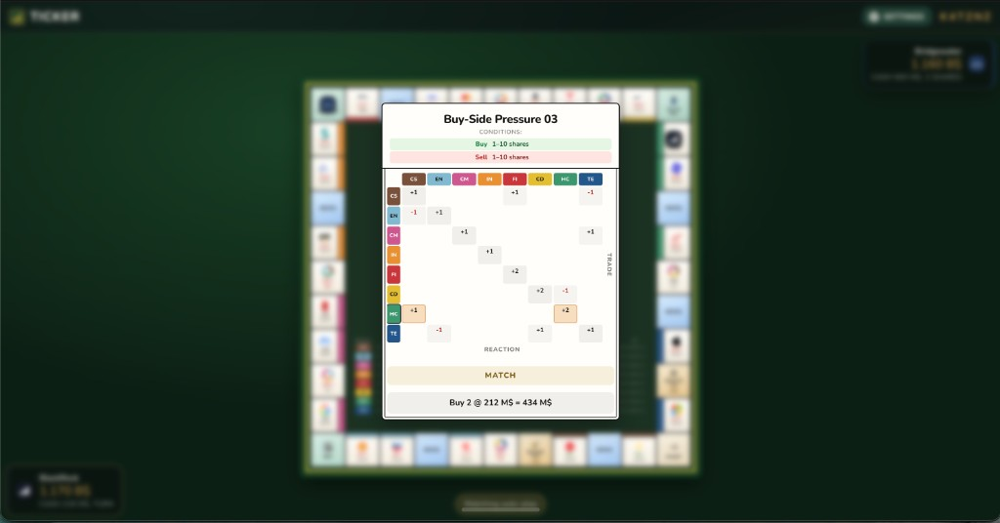
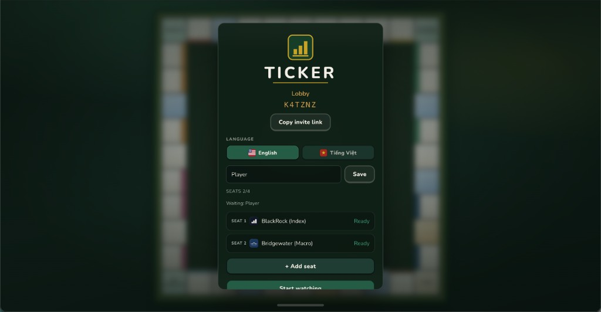

::: {.lang-vi}
**Trò chơi cờ chứng khoán nhiều người chơi**

**Chơi trực tuyến** [tickergame.vercel.app](https://tickergame.vercel.app/)  
**Hướng dẫn chơi** [tickergame.vercel.app/tutorial](https://tickergame.vercel.app/tutorial)  
**itch.io** [comrade-lenan.itch.io/ticker](https://comrade-lenan.itch.io/ticker)  
**Mã nguồn** [github.com/letrinhandn/ticker](https://github.com/letrinhandn/ticker)

## Tổng quan

TICKER (Cờ chứng khoán) là trò chơi bàn cờ chiến thuật nhiều người chơi lấy cảm hứng từ Cờ tỷ phú, với chủ đề và cơ chế giao dịch xoay quanh thị trường chứng khoán. Trò chơi được phát triển để chơi trực tiếp trên trình duyệt. Thay vì mua bán bất động sản, mỗi người điều hành một quỹ đầu tư, giao dịch cổ phiếu và chứng chỉ quỹ ETF, đồng thời quản lý tiền mặt trước các biến động thị trường và nghĩa vụ thanh toán.

Trò chơi kết hợp di chuyển bằng xúc xắc với các quyết định đầu tư. Giá cổ phiếu phụ thuộc vào mức ngành biến động trong khoảng từ −5 đến +5. Việc sở hữu cổ phần của những công ty có lợi nhuận tạo ra thu nhập khi quỹ đi qua ô START, trong khi tiền mặt phải chịu thuế tại ô này. Người chơi còn có thể nhận phí khi đối thủ ghé vào ô công ty mà mình nắm giữ cổ phần. Ván chơi kết thúc khi chỉ còn một quỹ chưa phá sản.

{fig-alt="Hình 1. Bìa trò chơi TICKER." fig-align="center"}

## Cơ chế trò chơi

### Bàn cờ và thị trường

Bàn chơi gồm các ô công ty, quỹ ETF, tin tức thị trường, thuế và những vị trí đặc biệt như START, Weekend và SEC Investigation. Mỗi lượt, người chơi đổ hai xúc xắc, di chuyển quân cờ và xử lý sự kiện tại ô dừng.

Thị trường được chia thành tám nhóm ngành, mỗi nhóm có một mức biến động từ −5 đến +5. Giá cổ phiếu và doanh thu trên mỗi cổ phần của công ty được xác định theo mức ngành hiện tại. Giá chứng chỉ quỹ ETF được tính từ giá trị của những nhóm ngành cấu thành. Các mức ngành thay đổi theo sự kiện thị trường và phản ứng giá khi giao dịch.

{fig-alt="Hình 2. Bàn chơi TICKER." fig-align="center"}

### Giao dịch và quản lý quỹ

Mỗi quỹ bắt đầu với 5.000 M$ tiền mặt. Khi đến ô công ty hoặc ETF, người chơi có thể thực hiện một lệnh mua hoặc bán theo quy tắc của trò chơi.

Khi ghé ô công ty, quỹ phải trả phí cho những người chơi khác đang sở hữu cổ phần của công ty đó. Số tiền mỗi người nhận được tính theo phí ghé ô trên mỗi cổ phần nhân với số cổ phần họ nắm giữ. Người chơi không phải trả phí cho cổ phần của chính mình. Ô ETF không phát sinh phí ghé ô.

{fig-alt="Hình 3. Thẻ thông tin công ty." fig-align="center"}

{fig-alt="Hình 4. Giao dịch mua cổ phiếu." fig-align="center"}

### Thuế và lợi nhuận khi qua ô START

Mỗi lần đi qua hoặc dừng tại ô START, quỹ phải nộp thuế bằng 10% số tiền mặt hiện có. Sau đó, hệ thống quyết toán kết quả kinh doanh của các công ty trong danh mục dựa trên doanh thu theo mức ngành, chi phí hoạt động và số cổ phần đang nắm giữ. Quỹ nhận tiền nếu kết quả ròng là lãi và phải thanh toán nếu kết quả là lỗ. ETF không tham gia quyết toán này.

Cơ chế này khuyến khích người chơi mua cổ phần của những công ty có khả năng sinh lời, thay vì chỉ tích trữ tiền mặt. Tuy nhiên, quỹ vẫn phải duy trì đủ thanh khoản để trả thuế, phí ghé ô và các nghĩa vụ bắt buộc khác. Nếu đã thanh lý tài sản có thể bán mà vẫn không thể thanh toán, quỹ sẽ phá sản và rời ván chơi.

### Tin tức và phản ứng giá

TICKER sử dụng hai bộ thẻ chính để tạo biến động thị trường. Thẻ Market News tác động đến trạng thái các nhóm ngành thông qua những sự kiện tăng hoặc giảm giá. Thẻ Price Reaction được sử dụng khi giao dịch cổ phiếu, khiến giá có thể thay đổi trước khi lệnh được thực hiện.

Hai cơ chế này buộc người chơi cân nhắc quy mô giao dịch, mức độ tập trung danh mục và rủi ro thanh khoản thay vì chỉ lựa chọn tài sản có giá thấp.

{fig-alt="Hình 5. Thẻ phản ứng giá." fig-align="center"}

{fig-alt="Hình 6. Thẻ tin tức thị trường." fig-align="center"}

## Chơi nhiều người và đối thủ máy

Mỗi phòng chơi hỗ trợ từ hai đến bốn vị trí quỹ. Người chơi có thể tạo phòng, chia sẻ mã tham gia và chọn một vị trí trong phòng chờ mà không cần đăng ký tài khoản. Giao diện có tiếng Việt và tiếng Anh.

TICKER hỗ trợ chơi cùng người khác, đấu với quỹ do máy điều khiển hoặc theo dõi một ván đấu giữa các quỹ tự động. Người tham gia có thể vào phòng với vai trò quan sát trước khi chọn vị trí. Nếu rời phòng giữa ván, quỹ đang điều khiển sẽ tiếp tục chơi tự động.

{fig-alt="Hình 7. Phòng chờ TICKER." fig-align="center"}

## Kiến trúc và phát triển

Giao diện trò chơi được xây dựng bằng Next.js với App Router. Phần đồng bộ nhiều người chơi sử dụng PartyServer trên Cloudflare Workers, kết hợp Durable Objects để duy trì một phiên xử lý riêng cho mỗi phòng. Cấu trúc mã nguồn tách phần hiển thị bàn cờ, dữ liệu thẻ, bộ luật, đối thủ máy và giao thức đồng bộ trạng thái.

Dự án cũng có các công cụ kiểm thử và mô phỏng nhiều ván nhằm đánh giá cân bằng giữa các chiến lược và cấu hình quỹ. Giao diện công khai được triển khai trên Vercel, trong khi máy chủ đồng bộ hoạt động trên Cloudflare. Trang itch.io dẫn đến phiên bản trò chơi trực tuyến này.

### Chạy trên máy cá nhân

```bash
npm install
cp .env.example .env.local
npm run dev:all
```

Đặt `NEXT_PUBLIC_PARTY_HOST=localhost:8888` trong tệp `.env.local`. Sau đó mở [http://localhost:3010](http://localhost:3010) để sử dụng trò chơi. Dịch vụ đồng bộ chạy trên cổng `8888`.

Tài liệu luật chơi được lưu trong [bộ luật phiên bản V5](https://github.com/letrinhandn/ticker/blob/main/docs/rulebook/MARKETPOLY_RULEBOOK_V5.md). Hướng dẫn dành cho người chơi có tại [trang hướng dẫn chính thức](https://tickergame.vercel.app/tutorial).

## Liên kết và tài nguyên

| | |
| --- | --- |
| Chơi trực tuyến | [tickergame.vercel.app](https://tickergame.vercel.app/) |
| Hướng dẫn chơi | [tickergame.vercel.app/tutorial](https://tickergame.vercel.app/tutorial) |
| itch.io | [comrade-lenan.itch.io/ticker](https://comrade-lenan.itch.io/ticker) |
| Mã nguồn | [github.com/letrinhandn/ticker](https://github.com/letrinhandn/ticker) |
| README | [Tài liệu dự án](https://github.com/letrinhandn/ticker#readme) |
| Luật chơi | [Bộ luật V5](https://github.com/letrinhandn/ticker/blob/main/docs/rulebook/MARKETPOLY_RULEBOOK_V5.md) |

*TICKER là trò chơi mô phỏng, không thực hiện giao dịch chứng khoán thật.*
:::

::: {.lang-en}
**Multiplayer Stock Market Board Game**

**Play** [tickergame.vercel.app](https://tickergame.vercel.app/)  
**Tutorial** [tickergame.vercel.app/tutorial](https://tickergame.vercel.app/tutorial)  
**itch.io** [comrade-lenan.itch.io/ticker](https://comrade-lenan.itch.io/ticker)  
**Source Code** [github.com/letrinhandn/ticker](https://github.com/letrinhandn/ticker)

## Overview

TICKER is a multiplayer strategy board game inspired by Monopoly, reimagined around stock market trading and playable directly in a web browser. Instead of buying and selling properties, each player manages an investment fund, trades company shares and exchange-traded fund (ETF) units, and maintains enough cash to meet payments as market conditions change.

The game combines dice-based movement with investment decisions. Share prices depend on sector levels ranging from −5 to +5. Holding shares in profitable companies can generate income when a fund passes START, while cash holdings are taxed at that space. Players can also collect fees when opponents land on company spaces in which they own shares. A match ends when only one solvent fund remains.

{fig-alt="Figure 1. TICKER game cover." fig-align="center"}

## Gameplay

### Board and Market

The board includes company spaces, ETFs, market news, taxes, and special locations such as START, Weekend, and SEC Investigation. Players roll two dice, move around the board, and resolve the effects of the spaces they land on.

The market is divided into eight sectors, each with a level ranging from −5 to +5. A company's share price and revenue per share are determined by its sector's current level. ETF unit prices are calculated from the values of their underlying sector components. Sector levels change in response to market events and price reactions during trading.

{fig-alt="Figure 2. TICKER game board." fig-align="center"}

### Trading and Fund Management

Each fund begins with 5,000 M$ in cash. Landing on a company or ETF space can open an opportunity to place one buy or sell order under the game's trading rules.

When a fund lands on a company space, it pays a visit fee to the other players who own shares in that company. Each shareholder receives the per-share visit fee multiplied by the number of shares they hold. Players do not pay fees on their own shares, and ETF spaces have no visit fees.

{fig-alt="Figure 3. Company deed card." fig-align="center"}

{fig-alt="Figure 4. Share purchase." fig-align="center"}

### Taxes and Operating Returns at START

Whenever a fund passes or lands on START, it first pays a tax equal to 10% of its current cash balance. The game then settles the operating results of the companies in its portfolio based on revenue at the current sector level, operating costs, and the number of shares held. The fund receives a payment for a net profit or makes a payment for a net loss. ETF holdings are excluded from this settlement.

This encourages players to invest in companies with the potential to generate profits rather than simply accumulate cash. At the same time, each fund must retain enough liquidity to cover taxes, visit fees, and other mandatory payments. A fund goes bankrupt if it cannot meet an obligation after liquidating all eligible holdings.

### Market News and Price Reactions

TICKER uses two main card decks to model market changes. Market News cards move sector levels in response to bullish or bearish events. Price Reaction cards apply to company share orders and may change prices before a trade is executed.

Together, these mechanics make order size, portfolio concentration, and liquidity relevant to each decision, rather than reducing the game to buying the cheapest available assets.

{fig-alt="Figure 5. Price Reaction card." fig-align="center"}

{fig-alt="Figure 6. Market News card." fig-align="center"}

## Multiplayer and Computer-Controlled Funds

Each room supports two to four fund seats. Players can create a room, share a short join code, and select a seat in the lobby without registering an account. The interface is available in English and Vietnamese.

TICKER supports matches between people, matches against computer-controlled funds, and spectator sessions watching automated funds play. Players enter a room as spectators before taking a seat. If a player leaves during a match, their fund continues playing automatically.

{fig-alt="Figure 7. TICKER lobby." fig-align="center"}

## Architecture and Development

The game interface is built with Next.js App Router. Real-time multiplayer sessions run on PartyServer through Cloudflare Workers, using Durable Objects to maintain a separate room instance for each match. The codebase separates the board interface, card content, game engine, computer-controlled opponents, and state synchronization protocol.

The project also includes tests and multi-game simulations for evaluating balance across strategies and fund configurations. The public interface is deployed on Vercel, while the real-time service runs on Cloudflare. The itch.io page links to this browser-based version.

### Running Locally

```bash
npm install
cp .env.example .env.local
npm run dev:all
```

Set `NEXT_PUBLIC_PARTY_HOST=localhost:8888` in `.env.local`, then open [http://localhost:3010](http://localhost:3010). The real-time server runs on port `8888`.

The project includes a [Version 5 rulebook](https://github.com/letrinhandn/ticker/blob/main/docs/rulebook/MARKETPOLY_RULEBOOK_V5.md). A player-facing explanation is available in the [official tutorial](https://tickergame.vercel.app/tutorial).

## Links and Resources

| | |
| --- | --- |
| Play | [tickergame.vercel.app](https://tickergame.vercel.app/) |
| Tutorial | [tickergame.vercel.app/tutorial](https://tickergame.vercel.app/tutorial) |
| itch.io | [comrade-lenan.itch.io/ticker](https://comrade-lenan.itch.io/ticker) |
| GitHub Repository | [github.com/letrinhandn/ticker](https://github.com/letrinhandn/ticker) |
| README | [Project Documentation](https://github.com/letrinhandn/ticker#readme) |
| Rulebook | [Version 5 Rules](https://github.com/letrinhandn/ticker/blob/main/docs/rulebook/MARKETPOLY_RULEBOOK_V5.md) |

*TICKER is a simulated board game and does not execute real securities trades.*
:::
